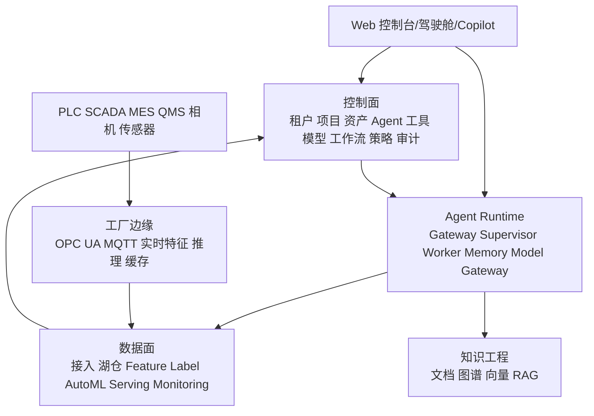

# 生产级总体架构

## 1. 分层

## 2. 服务边界

| 服务 | 生产职责 |
|---|---|
| platform-gateway | OIDC、租户路由、限流、API 聚合、幂等键 |
| agent-control | Agent/Tool/Workflow/Prompt/Policy 注册、版本和发布 |
| agent-runtime | Task 状态机、Supervisor、上下文、预算和子 Agent |
| tool-gateway | 工具鉴权、Schema 校验、SQL 沙箱、连接器路由、审计 |
| workflow-service | Temporal Worker、审批、超时、重试和补偿 |
| data-service | 数据源、数据契约、数据集、质量和血缘 |
| model-service | 实验、模型注册、模型卡、部署和回滚 |
| knowledge-service | 文档、分段、嵌入、图谱、RAG |
| audit-service | 不可篡改审计、执行轨迹和合规导出 |
| edge-agent | 工厂连接器、边缘队列、断网缓存和推理 |

## 3. Agent 执行约束

- Planner 只能输出 JSON Schema 约束的 Plan。
- Worker 只能执行已注册的 Tool Manifest。
- 所有工具调用带 `task_id`、`step_id`、`trace_id`、`idempotency_key` 和权限 scope。
- L1 及以上副作用操作进入审批；L3 OT 控制默认关闭。
- 外部文档视为不可信输入，不能覆盖系统策略和工具权限。
- 大文件进入对象存储，事件消息只传 artifact 引用。

## 4. 工业时延等级

| 等级 | 场景 | 目标 |
|---|---|---|
| L0 | 视觉、扭矩和安全相关实时推理 | 边缘 P95 < 100ms |
| L1 | 设备预警、质量预警 | 边缘秒级 |
| L2 | 根因、能耗、排产和知识分析 | 中心分钟级 |

## 5. 生产红线

- Agent 不直连 PLC。
- AI 不能替代独立安全回路。
- 模型必须影子/灰度后才能进入辅助或受控自动状态。
- 模型、镜像、Prompt、知识和策略必须可回滚。

